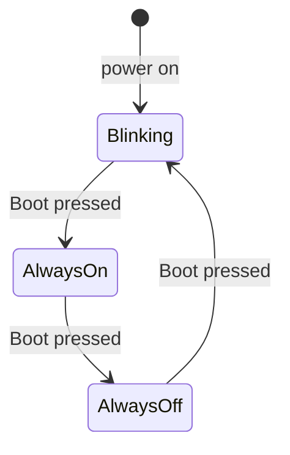

# Lesson 2.3: Embedded C Basics (ESP32-S3)


Beetroot Academy homework ([`TASK.md`](TASK.md)). The onboard RGB LED blinks without blocking delays, all settings live in one `static const` config struct, the superloop measures its own speed, and the **Boot** button (interrupt-driven) switches the LED mode.

## ✅ Requirements

| Requirement | Done | Where |
|---|:---:|---|
| `typedef enum` LED state (`LED_OFF` / `LED_ON`) | ✅ | [`led.h`](main/led.h) |
| LED module with `led_t`, `led_init(led, pin)` and `led_set(led, state)` | ✅ | [`led.h`](main/led.h) / [`led.c`](main/led.c) |
| `#define` only for include guards | ✅ | all files |
| No globals: file-scope `static` state, reached through functions | ✅ | [`button.c`](main/button.c), [`led.c`](main/led.c) |
| Non-blocking blink with the tick counter (`esp_timer_get_time()`) | ✅ | [`main.c`](main/main.c) |
| `config.h` with a `typedef struct` as a `static const` object, plus an anonymous `enum` | ✅ | [`config.h`](main/config.h) |
| No magic numbers, `const` parameters (`const led_t *led`) | ✅ | all files |
| No `malloc` / `free` | ✅ | all data is static or on the stack |
| ⭐ Superloop timing every 1000 iterations, `uint64_t` accumulator, `snprintf` into `char[]` | ✅ | `stats_*` in [`main.c`](main/main.c) |
| ⭐ Button interrupt, `static volatile bool button_pressed`, minimal ISR | ✅ | [`button.c`](main/button.c) |
| ⭐ Mode state machine with `switch`, time-based debounce and atomic flag clear in the main loop | ✅ | [`main.c`](main/main.c), [`button.c`](main/button.c) |

## 🔌 Hardware

Nothing to wire. Everything is on the board:

| Part | Pin | Notes |
|---|---|---|
| RGB LED (WS2812) | GPIO48 | Addressable LED, driven by `espressif/led_strip` over RMT |
| Boot button | GPIO0 | Active LOW, internal pull-up, falling-edge interrupt |

Board: VCC-GND YD-ESP32-S3 (an ESP32-S3-DevKitC-1 clone), connected over the USB-UART port (CH343).

## 💡 Modes (press Boot to go to the next one)



| Mode | LED |
|---|---|
| **Blinking** | Toggles every 500 ms (dim blue) |
| **Always On** | Stays on |
| **Always Off** | Stays off |

## 🧱 Structure

```
main/
├── main.c     // setup + superloop, mode state machine, loop timing
├── config.h   // app_config_t APP_CONFIG (pins, intervals, color) + enum constants
├── led.h/.c   // LED module: led_t, led_init, led_set, led_toggle
└── button.h/.c// Boot button: ISR flag, atomic read-and-clear, debounce
```

### How it works

- **Non-blocking blink.** Each iteration reads `esp_timer_get_time()` (µs) and toggles the LED when `blink_interval_ms` has passed. `last_toggle += interval` keeps the rhythm exact.
- **The ISR only sets a flag.** `button_isr` sets `static volatile bool button_pressed` and nothing else (it's `IRAM_ATTR`).
- **Atomic read-and-clear.** The main loop copies and clears the flag inside `portENTER_CRITICAL`, so an edge can't arrive between the read and the clear and be lost.
- **Time-based debounce.** After an edge, the loop waits `debounce_ms` (50 ms) and accepts the press only if the button is *still held*. Bounces during the wait are dropped, and so are the bounces when the button is released, because the pin is HIGH again by then.
- **Loop yield.** FreeRTOS's idle task must run, or the task watchdog complains. The loop ends with `vTaskDelay(1)`, which is one 1 ms tick (`CONFIG_FREERTOS_HZ=1000` in `sdkconfig.defaults`). This is a scheduler yield, not a blink delay, and it is excluded from the measured work time.
- **Timing.** Each iteration's work time (without the yield) is added to a `uint64_t` sum with min/max. Every 1000 iterations, the average, min, max and the full iteration period are printed with `snprintf` into a fixed `char[128]`.

## 🛠️ Build and flash

ESP-IDF v6.0.2:

```powershell
idf.py build
idf.py -p COM5 flash monitor
```

`sdkconfig.defaults` sets the target (`esp32s3`) and the 1 ms tick, so no `set-target` is needed.

## 📊 Results

Serial Monitor output:

```
(to be added after running on the board)
```
